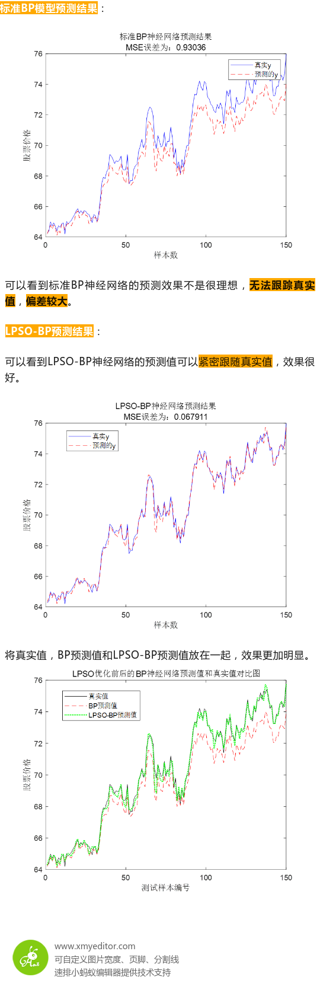
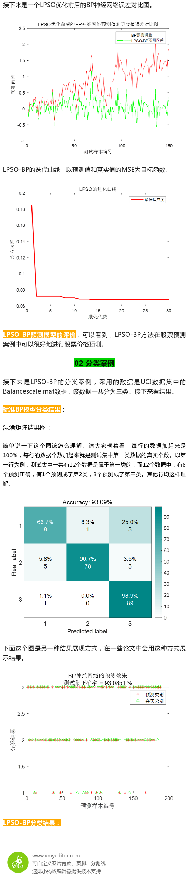
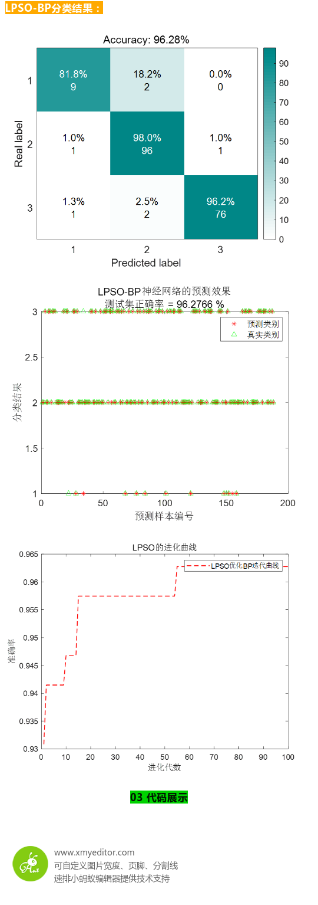

# Improved Particle Swarm Optimization for BP Neural Networks: Two Case Studies of Regression and Classification

Today, we optimized the Backpropagation Neural Network (BPNN) using an improved Particle Swarm Optimization (LPSO) algorithm. The LPSO algorithm used in this study is a previously published article on particle swarm optimization algorithms based on improved Levy flight and chaos mapping (10 different chaotic mappings can be switched at will). The accompanying MATLAB code is provided.
The paper discusses two cases: regression and classification. In the regression case, a classic stock data set was selected. For the classification case, the UCI public dataset was chosen.
Initial weights and thresholds of the BPNN are randomly generated, so they may not necessarily be optimal. By employing intelligent algorithms to optimize these weights and thresholds, it is possible to achieve a more perfect mapping relationship between inputs and outputs, thereby enhancing the accuracy of the BPNN model. This paper applies the LPSO algorithm to optimize the weights and thresholds of the BPNN and applies it to real-world regression and classification cases.
01 Stock Prediction Case
Although the case is introduced as a stock prediction, the LPSO-BP prediction model is universally applicable. You can replace your own data with the one provided in the paper. Replacing the data is very straightforward, and the code comments are very clear about how to do it.
%% Initialization\nclear\nclose all\nclc\nwarning off\naddpath(genpath(pwd));\n% rng(0)\nload Balancescale.mat \ndata = Balancescale;\ndata=data(randperm(size(data,1)),:);    % This line of code is used to shuffle the original samples, so that both training and test sets are randomly selected, which helps update prediction results.\ninput=data(:,2:end);\noutput1 =data(:,1);\nfor i=1:size(data,1)\n    switch output1(i)\n        case 1\n            output(i,1)=1;\n        case 2\n            output(i,2)=1;\n        case 3\n            output(i,3)=1;\n        case 4\n            output(i,4)=1;\n        case 5\n            output(i,5)=1;\n        case 6\n            output(i,6)=1;\n        case 7\n            output(i,7)=1;\n    end\nend\n%% Splitting the training set and test set\nm=fix(size(data,1)*0.7);    %Number of samples for training\n% Training set\ninput_train=input(1:m,:)';\noutput_train=output(1:m,:)';\n% Test set\ninput_test=input(m+1:end,:)';\noutput_test=output(m+1:end,:)';\n​\n%% Data normalization\n[inputn,inputps]=mapminmax(input_train,0,1);\ninputn_test=mapminmax('apply',input_test,inputps);\ndam = fix(size(inputn,2)*0.3);% 30% of the training set is selected as the validation set.\nidx = randperm(size(inputn,2),dam);\nXValidation = inputn(:,idx);\ninputn(:,idx) = [];\nYValidation = output_train(:,idx);\noutput_train(:,idx) = [];\n​\n%% Get the number of input and output layer nodes\ninputnum=size(input_train,1);\noutputnum=size(output_train,1);\ndisp('/////////////////////////////////')\ndisp('Neural network architecture...')\ndisp(['The number of nodes in the input layer is: ',num2str(inputnum)])\ndisp(['The number of nodes in the output layer is: ',num2str(outputnum)])\ndisp(' ')\ndisp('Process of determining the number of hidden layer nodes...')\n​\n% Determine the number of hidden layer nodes\n% Utilize the empirical formula hiddennum = sqrt(m + n) + a, where m is the number of input layer nodes and n is the number of output layer nodes, and a is generally an integer between 1 and 10.\nacc = 0;\nfor hiddennum=fix(sqrt(inputnum+outputnum))+1:fix(sqrt(inputnum+outputnum))+10\n    net0=newff(inputn,output_train,hiddennum);\n    % Network parameters\n    net0.trainParam.epochs=1000;            % The number of training times, set here to 1000 times.\n    net0.trainParam.lr=0.01;                % The learning rate is set to 0.01 here\n    net0.trainParam.goal=0.0001;           % Training objective minimum error, set to 0.0001 here\n    net0.trainParam.show=25;                % Frequency of display, set here to be displayed once every 25 training iterations\n    net0.trainParam.mc=0.001;                % Momentum factor\n    net0.trainParam.min_grad=1e-8;          % Minimum performance gradient\n    net0.trainParam.max_fail=6;             % The maximum number of failures\n    net0.trainParam.showWindow = false;\n    net0.trainParam.showCommandLine = false; \n    % Network Training\n    [net0,tr]=train(net0,inputn,output_train);\n    an0=sim(net0,XValidation);  % Simulation results of validation set\n    predict_label=zeros(1,size(an0,2));\n    for i=1:size(an0,2)\n        predict_label(i)=find(an0(:,i)==max(an0(:,i)));\n    end\n    outputt=zeros(1,size(YValidation,2));\n    for i=1:size(YValidation,2)\n        outputt(i)=find(YValidation(:,i)==max(YValidation(:,i)));\n    end\n    accuracy=sum(outputt==predict_label)/length(outputt);   % Calculate the predicted accuracy\n    disp(['The number of nodes in the hidden layer is',num2str(hiddennum),'At the time, the accuracy of the validation set was: ',num2str(accuracy)])\n    \n    % Update the best implicit layer nodes\n    if acc<accuracy\n        acc=accuracy;\n        hiddennum_best=hiddennum;\n    end\nend\ndisp(['The optimal number of hidden layer nodes is: ',num2str(hiddennum_best),', The accuracy of the training set corresponding to the validation set is: ',num2str(acc)])\n​\n%% Constructing the best hidden layer nodes of a BP neural network\ndisp(' ')\ndisp('StandardBPNeural network: ')\nnet0=newff(inputn,output_train,hiddennum_best,{'tansig','purelin'},'trainlm');% Establish model\n% Network Parameter Configuration\nnet0.trainParam.epochs=1000;         % The number of training times, set to 1000 here\nnet0.trainParam.lr=0.01;                   % The learning rate is set to 0.01 here\nnet0.trainParam.goal=0.00001;                    % Training objective minimum error, set to 0.0001 here\nnet0.trainParam.show=25;                % Frequency of display, set here to display once every 25 training iterations\nnet0.trainParam.mc=0.01;                 % Momentum factor\nnet0.trainParam.min_grad=1e-6;       % Minimum performance gradient\nnet0.trainParam.max_fail=6;               % The maximum number of failures\n% net0.trainParam.showWindow = false;\n% net0.trainParam.showCommandLine = false;            % Hide the simulation interface\n% Start training\nnet0=train(net0,inputn,output_train);\n​\n% Prediction\nan0=sim(net0,inputn_test); % Simulate with the trained model\npredict_label=zeros(1,size(an0,2));\n    for i=1:size(an0,2)\n        predict_label(i)=find(an0(:,i)==max(an0(:,i)));\n    end\n    outputt=zeros(1,size(output_test,2));\n    for i=1:size(output_test,2)\n        outputt(i)=find(output_test(:,i)==max(output_test(:,i)));\n    end\n    accuracy=sum(outputt==predict_label)/length(outputt);   % Calculate the predicted accuracy.\n    disp(['Accuracy rate: ',num2str(accuracy)])\n%% Standard BP neural network plotting\n% Draw a square\nfigure\nconfMat = confusionmat(outputt,predict_label);  %output_test is the real value label\nzjyanseplotConfMat(confMat.');  \nxlabel('Predicted label')\nylabel('Real label')\n% Draw a picture\nfigure\nscatter(1:length(predict_label),predict_label,'r*')\nhold on\nscatter(1:length(predict_label),outputt,'g^')\nlegend('Prediction category','True category','NorthWest')\ntitle({'BPPredictive effect of neural network',['Test set accuracy = ',num2str(accuracy*100),' %']})\nxlabel('Predicted sample number')\nylabel('Classification results')\nbox on\nset(gca,'fontsize',12)\n%% LPSO optimization algorithm to find the optimal threshold for weights\ndisp(' ')\ndisp('LPSOOptimizationBPNeural network: ')\n​\nnet=newff(inputn,output_train,hiddennum_best,{'tansig','purelin'},'trainlm');% Establish the model\n​\n% Network Parameter Configuration\nnet.trainParam.epochs=1000;         % The number of training times, set to 1000 here\nnet.trainParam.lr=0.0001;                   % Learning rate, set to 0.01 here\nnet.trainParam.goal=0.000001;                    % Training objective minimum error, set to 0.0001 here\nnet.trainParam.show=25;                % Frequency of display, set here to display once every 25 training iterations\nnet.trainParam.mc=0.01;                 % Momentum factor\nnet.trainParam.min_grad=1e-6;       % Minimum performance gradient\nnet.trainParam.max_fail=6;               % The maximum number of failures\n%% Initialize LPSO parameters\npopsize=20;   % Initial population size\nmaxgen=100;   %Maximum number of evolutionary generations\nlb = -1;  %Upper and lower bounds of neural network weights and thresholds\nub = 1;\nnumm = 2; % Chaotic coefficient\ndim=inputnum*hiddennum_best+hiddennum_best+hiddennum_best*outputnum+outputnum;    % Number of variables\n[Best_score,Best_pos,LPSO_curve]=LPSOforBP(numm,popsize,maxgen,lb,ub,dim,inputnum,hiddennum_best,outputnum,net,inputn,output_train,inputn_test,output_test);\n​\n​\nThe code contains detailed comments, including comments on the construction of neural networks.LPSO-BPCode comments are simple and easy to understand.。  
A single instance of obtaining two case codes.

## Images

<!-- PAYMENT_BLOCK -->

## Get this dataset

- Payment link (Stripe): [Buy now](https://buy.stripe.com/3cs8yP7sY87d0vu9AB)
- Payment QR code: 

<!-- /PAYMENT_BLOCK -->
